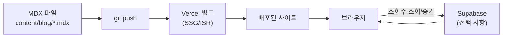

# Next.js 기술 블로그 겸 포트폴리오 구축 계획

2026-09-21 · @Someone

Next.js + MDX + Vercel 스택으로 기술 블로그 겸 포트폴리오 사이트를 구축하는 전체 계획입니다.

## 1. 아키텍처 개요

작성자는 로컬에서 MDX 파일만 쓰고 커밋하면, 나머지는 Vercel이 자동으로 빌드·배포합니다. 조회수처럼 실시간으로 바뀌는 값만 Supabase를 거쳐 브라우저에서 직접 불러옵니다.



핵심 원칙은 **콘텐츠(글)는 정적으로, 동적인 값만 별도 서비스로** 분리하는 거예요. 이렇게 하면 서버를 직접 운영할 필요 없이 Vercel(호스팅)과 Supabase(DB)라는 두 매니지드 서비스만으로 전체 인프라가 끝납니다.

## 2. 전체 폴더 구조

```text
my-portfolio/
├── app/                          # Next.js App Router
│   ├── layout.tsx                # 전체 레이아웃 (헤더/푸터/다크모드)
│   ├── page.tsx                  # 메인 페이지 (자기소개 + Featured)
│   ├── globals.css
│   ├── blog/
│   │   ├── page.tsx              # 블로그 글 목록
│   │   └── [slug]/
│   │       └── page.tsx          # 개별 글 상세 페이지 (MDX 렌더링)
│   ├── portfolio/
│   │   └── page.tsx              # 프로젝트/경력 페이지
│   └── api/
│       └── views/
│           └── route.ts          # 조회수 조회·증가 API (Supabase 연동)
│
├── content/
│   └── blog/
│       ├── my-first-post.mdx     # frontmatter(title, date, tags) + 본문
│       └── another-post.mdx
│
├── components/
│   ├── Header.tsx
│   ├── Footer.tsx
│   ├── PostCard.tsx              # 글 목록의 카드 UI
│   ├── ProjectCard.tsx           # 포트폴리오 프로젝트 카드
│   ├── ViewCounter.tsx           # 조회수 표시 컴포넌트
│   └── MDXComponents.tsx         # MDX 안에서 쓸 커스텀 컴포넌트(코드블록 등)
│
├── lib/
│   ├── posts.ts                  # MDX 파일 목록 읽기·파싱 유틸
│   └── supabase.ts               # Supabase 클라이언트 초기화
│
├── public/
│   └── images/
│
├── next.config.mjs
├── tailwind.config.ts
├── tsconfig.json
└── package.json
```

**포인트**

- `content/blog/`의 MDX 파일 하나 = 글 하나. `lib/posts.ts`에서 `fs.readdirSync`로 목록을 읽고 `gray-matter`로 frontmatter를 파싱해요.
- `app/api/views/route.ts` 하나만 있으면 Route Handler로 Supabase에 조회수를 읽고 쓸 수 있어요 (지난번 본 사이트의 `trackPostVisit`과 같은 역할).
- `components/`와 `lib/`을 분리해서, UI와 데이터 로직이 섞이지 않게 했어요.

## 3. 단계별 구축 계획

| 단계 | 내용 | 산출물 |
| --- | --- | --- |
| 1. 프로젝트 초기 세팅 | `create-next-app`(App Router, TypeScript, Tailwind 옵션 포함)으로 시작, ESLint/Prettier 설정, 깃허브 레포 생성 | 빈 Next.js 프로젝트가 로컬에서 실행됨 |
| 2. MDX 파이프라인 구축 | `gray-matter`로 frontmatter 파싱, `next-mdx-remote`(또는 `@next/mdx`)로 렌더링. `lib/posts.ts`에 글 목록/상세 조회 함수 작성 | 마크다운 글 1\~2개가 실제로 페이지에 렌더링됨 |
| 3. 레이아웃 & 디자인 | 헤더/푸터, 다크모드 토글, 반응형 레이아웃. Tailwind로 타이포그래피·컬러 시스템 정리 | 데스크톱/모바일 모두 보기 좋은 기본 틀 완성 |
| 4. 블로그 목록·상세 페이지 | `/blog` 목록 페이지(카드 UI, 태그 필터), `/blog/[slug]` 상세 페이지(코드 하이라이팅 포함) | 글을 실제로 쓰고 읽을 수 있는 블로그 완성 |
| 5. 포트폴리오 섹션 | 자기소개, 경력/인턴, 프로젝트 카드, 기술 스택 태그 등 (`/portfolio` 또는 메인 페이지에 통합) | 취업용으로 보여줄 수 있는 포트폴리오 완성 |
| 6. 1차 배포 | 깃허브 레포를 Vercel에 연결, 환경변수 설정, 커스텀 도메인 연결 | 실제 URL로 접속 가능한 사이트 오픈 |
| 7. 동적 기능 추가 (선택) | Supabase 프로젝트 생성 → `post_visits` 테이블 → Route Handler + `ViewCounter` 컴포넌트로 조회수 구현 | 글마다 조회수가 표시됨 |
| 8. SEO & 성능 최적화 | `metadata` API로 OG 태그, `sitemap.xml`/`robots.txt` 자동 생성, `next/image`로 이미지 최적화, Lighthouse 점검 | 검색 노출과 로딩 속도 개선 |
| 9. 운영 루틴 확립 | 글쓰기 템플릿 정리, Vercel Analytics(또는 GA4) 연동, 정기적으로 글 발행 | 꾸준히 업데이트되는 살아있는 사이트 |

1\~6단계까지가 "취업 전 꼭 필요한 최소 버전(MVP)"이고, 7\~9단계는 완성 후 여유 있을 때 붙이면 되는 확장 단계예요.

## 4. 기술 스택 요약

| 레이어 | 선택 기술 | 비고 |
| --- | --- | --- |
| 프레임워크 | Next.js (App Router) | 라우팅, 이미지 최적화, API Route 내장 |
| 언어 | TypeScript | 취업 시장에서 기본값처럼 요구됨 |
| 스타일링 | Tailwind CSS | 빠른 개발, 지난번 본 사이트와 동일 |
| 콘텐츠 | MDX + gray-matter | 마크다운 안에 React 컴포넌트 삽입 가능 |
| 호스팅/배포 | Vercel | git push 시 자동 빌드·배포 |
| 동적 DB (선택) | Supabase | 조회수, 방명록 등 실시간 기능용 |
| 분석 | Vercel Analytics 또는 GA4 | 방문자 통계 확인 |
| 코드 품질 | ESLint + Prettier | 협업/포트폴리오용 코드 컨벤션 |

## 5. 향후 확장 아이디어

- **조회수 / 인기글**: Supabase `post_visits` 테이블 (지난번 정인영 님 사이트와 동일한 패턴)
- **댓글/방명록**: Supabase 테이블 + 간단한 폼, 또는 Giscus(GitHub Discussions 연동) 활용
- **태그별 필터링·검색**: frontmatter의 `tags`를 기준으로 클라이언트 사이드 필터
- **RSS 피드**: `feed` 패키지로 `/rss.xml` 자동 생성
- **다크모드**: `next-themes`로 시스템 설정 감지 + 토글
- **이력서 다운로드 버튼**: `/resume.pdf` 정적 파일 제공
- **연관 글 추천**: 같은 태그를 공유하는 글 자동 매칭 (지난번 본 사이트에도 있던 기능)

한 번에 다 만들 필요 없이, 3단계(MVP) 배포 후 우선순위대로 하나씩 추가하는 걸 추천해요.
